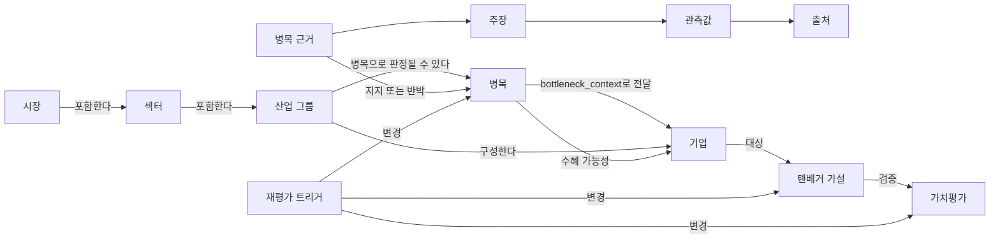
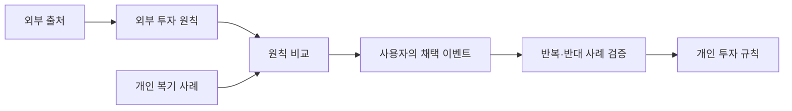

# 관계성 지도

이것은 폴더 목록이 아니라, 투자 판단에 쓰는 객체와 관계의 지도다.

## 이 관계를 읽는 법

1. [[시장]]과 [[섹터]]는 탐색 범위다.
2. [[산업 그룹]]은 점수를 내고 병목을 판정하는 단위다.
3. [[병목]]은 “수요가 강하다”가 아니라 특정 공급 제약의 상태다.
4. [[병목 근거]]는 그 상태를 지지하거나 반박한다.
5. [[기업]]은 병목의 수혜를 받는지 검증받는 대상이다.
6. [[텐베거 가설]]과 [[가치평가]]는 기업이 실제 투자 후보가 될 수 있는지 판단한다.
7. [[재평가 트리거]]는 모든 결론을 다시 열 수 있다.

## 핵심 경계

`산업 그룹 → 병목 → 기업` 사이에는 [[04. 병목 전달 문맥]]이 있다.

이 경계가 있어서 “잘 나가는 기업”을 보고 나중에 병목 이유를 끼워 맞추는 것을 막는다.

## 데이터가 채워진 시범 결과

관계와 실제 실행값이 함께 들어간 한 장짜리 결과는 [[결과물/시범 결과 - 5740 AI 패키징 병목]]에서 본다.

## 외부 관점에서 개인 규칙으로

[[성상현 부부장/00. 성상현 부부장 투자철학 지도]]와 [[투자철학/00. 나만의 투자철학 만들기]]에서 구체적인 노드를 확인한다.

## 전체 세컨드 브레인 관계
위 지도는 산업 발굴 모듈의 상세 관계다. 전체는 [[00. 시작하기]]의 `사용자 진술 → 복기 → 피드백 → 규칙 채택 → 시점별 분석 → 사용자 결정 → 복기` 흐름이다. 외부 지식은 피드백·새 분석으로 들어가며 개인 과거 기억으로 들어가지 않는다.
