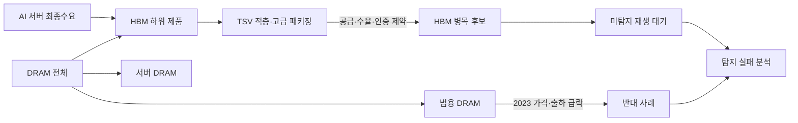

# 병목 사례 한판 보기: HBM vs DRAM

> [!note]
> 이 대시보드는 실제 공개 자료를 이용한 역사 사례 비교다. HBM의 “코드 미탐지” 여부는 과거 유니버스 재생 전까지 확정하지 않는다.

## 결론 요약

| 사례 | 분석 단위 | 수요 | 공급 | 가격·이익 | 현재 온톨로지 상태 |
|---|---|---|---|---|---|
| [[결과물/실제 사례 - HBM 2023-2024]] | HBM 제품·고급 패키징 공정 | AI 고객 수요·생산계획 매진 | 수율·열 제어·고객 인증 장벽 | 고부가 제품 믹스·메모리 회복 | 병목 후보 / 재생 대기 |
| [[결과물/실제 사례 - DRAM 2022-2024]] | DRAM 전체 제품군 | 2023 약세, 2024 AI 중심 회복 | 범용 공급은 사이클 영향 | 2023 ASP 급락, 2024 반등 | 광범위 병목 아님 / 혼합 사이클 |

## 판단 경로



## 근거 요약

### HBM

- SK hynix: 2024년 계획 HBM 생산량이 이미 매진됐다고 발표
- SK hynix: HBM3E를 2024년 상반기 양산, 고적층·열 제어 기술 필요
- Micron: 2024년 HBM3E 양산 시작, HBM을 포함한 AI 서버 메모리 수요 증가 설명
- Micron: DRAM 매출 2023년 `$10.98B` → 2024년 `$17.60B`, 2024년 ASP low-teens 증가

### DRAM

- Micron: 2023년 약한 수요와 고객 재고 축소
- Micron: 2023년 DRAM ASP high-40% 범위 하락, bit shipments high-single-digit 감소
- Micron: 2024년 DRAM 매출 +60%, bit shipments mid-40% 증가, ASP low-teens 증가
- Samsung: 2024년 2분기 HBM·conventional DRAM·서버 SSD 수요 회복 언급

## 왜 HBM은 놓칠 수 있는가

아래 표가 “왜 놓칠 수 있었는가”를 코드 단계별로 분해한 것이다. **현재 저장소에서 실제 과거 유니버스를 재생하지 않았으므로, 원인 후보와 확인 완료를 구분한다.**

| 가능 원인     | 놓치는 코드 단계                | 논리적 이유                                                                            | 현재 상태                     |
| --------- | ------------------------ | --------------------------------------------------------------------------------- | ------------------------- |
| 분석 단위 불일치 | `universe` / `aggregate` | HBM은 섹터가 아니라 DRAM 안의 제품·패키징 공정이다. Valley의 그룹이 HBM을 별도 그룹으로 주지 않으면 범용 DRAM과 섞인다.   | 구조상 가능성 확인, 실제 유니버스 확인 필요 |
| 하위 병목 희석  | `aggregate`              | HBM의 고성장·고마진이 메모리 전체 시가총액 가중평균에 묻힐 수 있다.                                          | 재생 필요                     |
| 수요 신호 시차  | `derive`                 | 코드는 예상 EV/Sales·마진과 LTM 파생값을 사용한다. 고객 인증·수율·선행 주문은 재무 추정치보다 먼저 나타날 수 있다.          | 재생 필요                     |
| 가격·마진 혼합  | `derive` / `score`       | 범용 DRAM 가격 하락과 HBM 가격·믹스 개선이 같은 그룹 평균에서 상쇄될 수 있다.                                 | 재생 필요                     |
| 3년 지속 게이트 | `qualitative`            | 2023년 초기에는 HBM 수요는 보여도 3년 이상 공급 제약을 입증할 출처가 부족했을 수 있다. `duration_years > 3`가 필수다. | 당시 출처 재검증 필요              |
| 상위 3개 제한  | `score` / `gate`         | 다른 산업군 점수가 더 높으면 HBM 하위 신호가 정성 검증 큐에 못 들어간다.                                      | 재생 필요                     |
| 전달 문맥 검증  | `handoff`                | 산업 그룹·출처·확인일·지속기간 중 하나라도 없으면 `candidate_pool_passed`가 거짓이 된다.                     | 규칙으로 확인됨                  |

## 현재 결론과 확정 방법

따라서 지금 말할 수 있는 결론은 다음까지다.

```text
HBM이 실제로 놓쳤다고 확정할 수는 없음
하지만 현재 설계는 제품·공정 하위 병목을 희석시킬 구조적 경로를 가짐
```

확정하려면 HBM 수요가 공개되기 시작한 기준일을 고정하고, 당시 데이터로 다음을 비교한다.

```text
기존 그룹 분류로 실행
  vs
HBM·서버 DRAM·범용 DRAM을 하위 그룹으로 분해해 실행
```

두 실행에서 `aggregate`, `score`, `gate` 중 최초로 결과가 갈리는 지점이 실제 미탐지 원인이다. 이 작업은 [[프로세스/탐지 실패 분석]]의 `historical_cutoff`와 `miss_stage`에 기록한다.

## 온톨로지 연결

```text
[[출처]]
  → [[관측값]]
    → [[주장]]
      → [[병목 근거]]
        → [[병목]]
          → [[산업 그룹]]
            → [[기업]]
```

실제 사례 노트에는 이 연결과 함께 출처 URL·발행일·확인일을 남겼다. 다음 단계는 HBM·DRAM의 과거 기준일 유니버스를 확보해 `universe → aggregate → score → gate` 중 최초 실패 지점을 찾는 것이다.

## 원문 출처

- [SK hynix: 2024 HBM production sold out](https://news.skhynix.com/en/new-leadership-spotlight-vice-president-kitae-kim-head-of-hbm-sales-and-marketing/)
- [SK hynix: HBM3E development and production](https://news.skhynix.com/en/sk-hynix-develops-worlds-best-performing-hbm3e/)
- [Micron 2024 Form 10-K](https://www.sec.gov/Archives/edgar/data/723125/000072312524000027/mu-20240829.htm)
- [Samsung Q2 2024 results](https://news.samsung.com/global/samsung-electronics-announces-results-for-second-quarter-of-2024)

## 다음 액션

- [ ] HBM 역사적 기준일과 `detectability_status` 확정
- [ ] 당시 데이터셋 등록 ([[데이터셋]])
- [ ] 알고리즘 재생 ([[프로세스/탐지 실패 분석]])
- [ ] HBM 하위 제품·공정 분해가 필요한지 판정
- [ ] DRAM 전체를 반대 사례 회귀 테스트에 포함
