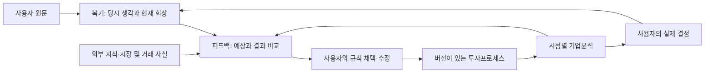

# 내 투자 세컨드 브레인

**내가 실제로 했던 생각을 보존하고 → 결과·새 지식과 비교하고 → 나만의 투자프로세스를 고치고 → 다음 기업 분석과 결정에 적용한다.** 큰 수익은 목표이며, 기록 체계가 수익을 보장하거나 실력이 이미 검증됐다는 뜻은 아니다.

## 평소에는 이 다섯 곳만 연다
| 영역 | 여는 문서 | 담는 것 |
| --- | --- | --- |
| 1. 내 기억·판단 | [[복기/00. 복기 진행판|복기]] | 내가 직접 말한 당시 생각·현재 회상. 출처 없는 생각은 미상 |
| 2. 결과와 비교 | [[피드백/00. 피드백 지도|피드백]] | 과거 예상과 실제 결과, 분석자의 설명·반대 가설 |
| 3. 나의 방법 | [[투자철학/00. 나만의 투자철학 만들기|투자프로세스]] | 채택·보류·수정한 규칙과 적용 절차·버전 |
| 4. 다음 투자 | [[기업분석/00. 기업분석 기록|기업분석·결정]] | 시점별 분석, 사용한 규칙, 실제 사용자 결정과 이후 비교 |
| 5. 참고 지식 | [[자료실/00. 자료실 지도|자료실]] | 외부 자료·시장 사실·과거 연구·보존한 혼합 문서 |

**외부 지식이나 AI의 추론에서 ‘당시 내 생각’으로 직접 연결하지 않는다.** 공개됐던 자료와 내가 실제로 읽고 사용한 자료는 다르다. 회상과 당시 기록도 구분한다.

## 한 번의 훈련을 처음부터 끝까지 보기

[[피드백/훈련 기록/TR-001 HBM 수급 예상|TR-001 HBM 수급 예상]]을 열면 **무슨 말을 했고 → 어떤 피드백이 나왔고 → 왜 방법을 바꿨고 → 다음에 무엇을 적용하고 → 결과를 어떻게 다시 비교할지** 순서대로 볼 수 있다. 현재는 다음 기업에 적용하기 전 단계다.

## 지금 쌓인 사례
- [[복기/투자 사례/플루언스 에너지]]: 직접 회고와 기존 인터뷰 요약을 분리했다.
- [[복기/투자 사례/PoET Technologies]]: 기존 인터뷰 원문 대조 대기.
- [[복기/투자 사례/SK하이닉스 - 메모리 기회 인식 복기]]: 동기 미상과 사용자 정정을 보존했다.
- 새 적용 규칙: [[투자철학/개인 투자 규칙/PR-001 수요와 공급의 변화 속도 비교]].

## 구조와 운영 확인
- 전체 점검 결과: [[자료실/2026-09-28 세컨드 브레인 구조 점검]].
- 기록 경계와 출처 규칙: [[99. 온톨로지 운영 규칙]].
- 객체·관계 정의: [[01. 온톨로지 스키마]]. 상세 정의이며 매일 읽을 필요는 없다.
- 과거 산업 발굴 설계: [[00. 투자 발굴 지도]]. 현재 없는 코드와 실제 작동하는 기능을 구분한다.

기존 폴더는 링크 안정성을 위해 대부분 유지했다. `개념/`은 공통 사전, `프로세스/`는 실행 절차, `09. 병목 판정 체계/`는 기존 발굴 모듈, `10. 시범 실행/`은 시범 데이터다. 이들은 위 다섯 영역의 보조 자료다.
