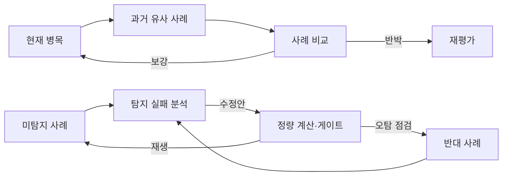

# 미탐지·반대 사례 검증 지도



## 판정의 균형

```text
미탐지 사례를 줄이는 방향 = 민감도 개선
반대 사례를 통과시키지 않는 방향 = 특이도 보존
```

둘 중 하나만 최적화하면 로직이 무너진다. HBM·DRAM처럼 하위 공정이 상위 분류에 묻힐 수 있는 후보는 미탐지 분석으로, 단기 수급·테마 급등처럼 병목으로 오인하기 쉬운 후보는 반대 사례로 등록한다.

## 시작점

- [[개념/미탐지 사례]]
- [[개념/반대 사례]]
- [[프로세스/탐지 실패 분석]]
- [[09. 병목 판정 체계/00. 병목 판정 운영판]]

실제 사례 검토:

- [[결과물/실제 사례 - HBM 2023-2024]] — 하위 제품·공정 병목 후보
- [[결과물/실제 사례 - DRAM 2022-2024]] — 상위 제품군 혼합으로 인한 반대 사례
