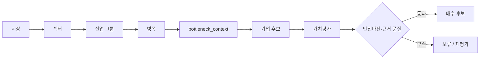

# 투자 발굴 지도

관계 자체를 먼저 보고 싶다면 [[00. 관계성 지도]]를 연다.

## 읽는 순서

1. [[02. 시장과 산업 분류]]에서 관찰 단위를 정한다.
2. [[03. 병목 판정]]에서 산업 그룹을 병목으로 판정한다.
3. [[04. 병목 전달 문맥]]으로 정량·정성 근거를 고정한다.
4. [[05. 텐베거 후보 선별]]과 [[06. 가치평가와 의사결정]]으로 기업 단위 판단을 한다.

## 핵심 원칙

- 병목은 기업이 아니라 가치사슬의 처리량을 제한하는 **산업 그룹 수준의 상태**다.
- `bottleneck_context` 없이 기업을 최종 텐베거 후보로 승격하지 않는다.
- 데이터 부족은 0점이 아니라 `보류` 또는 `reference_only` 상태다.

관련 구현: `docs/flow.md`, `scripts/bottleneck.py`, `scripts/tenbagger_pick.py`

## 2026-09-28 신규 발굴 연결
사용자 채택 [[투자철학/개인 투자 규칙/PR-001 수요와 공급의 변화 속도 비교]]에 따라 [[프로세스/수요와 실효 공급 비교]]를 수행한다. 산업 그룹 점수와 별도로 제품·세대·공정별 수급 가설에서 연구 후보를 만들 수 있다. 상위 그룹 점수·3년 지속은 기존 모듈 기준이지 모든 조사 대상의 선행 조건은 아니다. 연구 후보와 최종 투자 후보를 구분한다.

수요량·실효 공급량·재고·기간·부족 및 해소 시나리오 → 기업의 이익 귀속 → 가치평가를 [[기업분석/템플릿/시점별 기업 분석]]에 기록한다.

기존에 인용한 `scripts/bottleneck.py`, `scripts/tenbagger_pick.py` 등 핵심 코드는 현재 작업 트리에 없다. 위 점수·게이트는 설계 문서이며 이 수정으로 자동 실행기가 복구되거나 구현된 것은 아니다.
