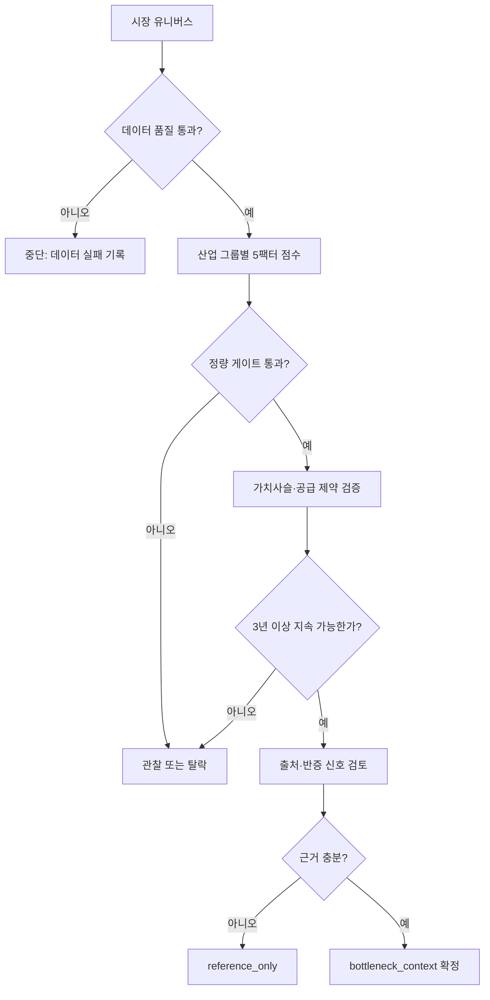

# 병목 판정 운영판

이 노트는 “어느 산업 그룹이 지금 구조적 병목인가?”를 일관되게 판정하는 작업 순서다. 한 산업 그룹마다 [[09. 병목 판정 체계/05. 산업 그룹 병목 카드 템플릿]]을 복제해 사용한다.

## 판정 흐름

## 작업 순서

1. [[09. 병목 판정 체계/01. 데이터 품질 게이트]]를 먼저 통과시킨다.
2. [[09. 병목 판정 체계/02. 정량 점수와 후보 압축]]으로 상위 3개 산업 그룹만 남긴다.
3. [[09. 병목 판정 체계/06. 병목 근거 수집법]]으로 수요·공급·가격 자료를 모은다.
4. [[09. 병목 판정 체계/03. 정성 병목 검증]]으로 “왜 이 구간인가”를 설명한다.
5. [[프로세스/과거 유사 사례 검색]]으로 지속기간과 해소 경로를 비교한다.
6. [[프로세스/탐지 실패 분석]]으로 미탐지·반대 사례를 재생한다.
7. [[09. 병목 판정 체계/04. 반증과 재평가]]에서 가설을 깨는 신호를 적는다.
8. 통과한 경우만 [[04. 병목 전달 문맥]]을 만들어 [[05. 텐베거 후보 선별]]로 넘긴다.

## 상태 정의

| 상태 | 의미 | 다음 행동 |
| --- | --- | --- |
| `관찰` | 테마는 있으나 정량 또는 근거가 부족 | 다음 데이터·근거 수집 |
| `정량 통과` | 점수 게이트만 통과 | 정성 검증 수행 |
| `병목 확정` | 정량·정성·근거 모두 통과 | `bottleneck_context` 생성 |
| `reference_only` | 계산 또는 근거가 후보 승격에 부족 | 참고 분석으로 유지 |
| `탈락` | 병목 가설이 반증됨 | 반증 사유 보존 |
| `재평가` | 새 정보가 결론을 바꿀 수 있음 | 트리거 발생 시 재검토 |

## 2026-09-28 신규 발굴 연결
사용자 채택 [[투자철학/개인 투자 규칙/PR-001 수요와 공급의 변화 속도 비교]]에 따라 [[프로세스/수요와 실효 공급 비교]]를 수행한다. 산업 그룹 점수와 별도로 제품·세대·공정별 수급 가설에서 연구 후보를 만들 수 있다. 상위 그룹 점수·3년 지속은 기존 모듈 기준이지 모든 조사 대상의 선행 조건은 아니다. 연구 후보와 최종 투자 후보를 구분한다.

수요량·실효 공급량·재고·기간·부족 및 해소 시나리오 → 기업의 이익 귀속 → 가치평가를 [[기업분석/템플릿/시점별 기업 분석]]에 기록한다.

기존에 인용한 `scripts/bottleneck.py`, `scripts/tenbagger_pick.py` 등 핵심 코드는 현재 작업 트리에 없다. 위 점수·게이트는 설계 문서이며 이 수정으로 자동 실행기가 복구되거나 구현된 것은 아니다.
