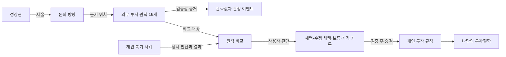

# 성상현 부부장 투자철학 지도

『돈의 방향』의 관점을 개인 복기와 구분해 보관하는 공간이다. 폴더명은 사용자 요청을 따르며, 책의 저자 표기는 **성상현(매크로비욘드 레오성)**이다. 직함의 현재 재직 여부는 이 자료로 판정하지 않는다.

핵심 흐름은 **거시 국면 → 자본이 향하는 산업과 병목 → 시장이 선택하는 기업 → 재무 개선 → 가치와 자본 배분 → 비중·출구 관리**다. 책의 주장을 추출한 것이며, 모든 원칙의 사용자 채택 여부는 아직 미정이다.

## 먼저 읽을 문서

1. [[성상현 부부장/출처/돈의 방향]]: 원본 경로·판본·쪽수·검증 범위.
2. [[성상현 부부장/01. 전체 독서 지도]]: 본문 5부와 부록 4개를 연결한 독서 지도.
3. [[성상현 부부장/02. 선별 모형과 지표]]: COMP, 한국 특화 F-스코어, 해외 모형의 차이.
4. [[성상현 부부장/03. 비중과 매도 규칙]]: 전략별 한도와 원문 내부의 다른 설명.
5. [[성상현 부부장/04. 거시와 병목의 인과 관계]]: 자본지출이 주주 수익까지 연결되는 경로.
6. [[성상현 부부장/05. 해석 유의점과 검증 과제]]: 재현 공백·성과 검증·원문 불일치.
7. [[투자철학/01. 성상현 관점과 내 복기 비교]]: 플루언스·PoET와의 첫 비교.

## 원칙을 적용한 사례

- [[성상현 부부장/사례/하이닉스 전체 운용 원칙과 유예 재검토]]: 유예 누락을 정정한 최신 운용 검토. 전체 원칙별 적용 상태·이벤트 일정·유예 후 가격 경계·근거 유지 보유를 구분한다.

- [[성상현 부부장/사례/하이닉스 상승을 포착할 수 있었는가]]: 2026-10-08 작성. 당시 공개 자료를 원칙에 대입한 재구성이며 저자의 실제 매매나 사용자의 개인 복기가 아니다. 상승 후보 포착·10배 예측·보유 성공을 분리한다.
- 학습 흐름: [[피드백/훈련 기록/TR-002 성상현 원칙으로 하이닉스 점검]].

## 원칙 목록

| ID | 원칙 | 원문 PDF 쪽수 |
| --- | --- | --- |
| SSH-C01 | [[성상현 부부장/원칙/SSH-C01 산업의 자본 흐름에서 기업으로 내려온다\|산업의 자본 흐름에서 기업으로 내려온다]] | 53, 54, 66, 70, 237, 238 |
| SSH-C02 | [[성상현 부부장/원칙/SSH-C02 병목의 수혜는 기업의 이익으로 확인한다\|병목의 수혜는 기업의 이익으로 확인한다]] | 188, 189, 194, 195, 199, 203, 236, 239 |
| SSH-C03 | [[성상현 부부장/원칙/SSH-C03 네 팩터와 주도주의 생애주기를 함께 본다\|네 팩터와 주도주의 생애주기를 함께 본다]] | 27, 28, 29, 40, 42, 44, 46, 47, 48 |
| SSH-C04 | [[성상현 부부장/원칙/SSH-C04 일회성 급등보다 지속적인 상대강도를 본다\|일회성 급등보다 지속적인 상대강도를 본다]] | 52, 53, 74, 75, 76, 77, 80, 81, 83, 85, 87 |
| SSH-C05 | [[성상현 부부장/원칙/SSH-C05 재무의 수준과 개선 방향을 구분한다\|재무의 수준과 개선 방향을 구분한다]] | 100, 101, 102, 103, 104, 105, 106, 107, 112, 113 |
| SSH-C06 | [[성상현 부부장/원칙/SSH-C06 시장 신호와 재무 증거를 교차 검증한다\|시장 신호와 재무 증거를 교차 검증한다]] | 109, 110, 114, 115, 118, 121, 123, 124, 125, 129 |
| SSH-C07 | [[성상현 부부장/원칙/SSH-C07 적정가치는 가정이 붙은 범위로 다룬다\|적정가치는 가정이 붙은 범위로 다룬다]] | 130, 132, 135, 136, 138, 139, 141, 142, 143, 145, 146, 147 |
| SSH-C08 | [[성상현 부부장/원칙/SSH-C08 매수 전에 철회 조건을 정한다\|매수 전에 철회 조건을 정한다]] | 54, 149, 150, 151, 152, 153, 154, 155, 156, 157, 200, 201, 242 |
| SSH-C09 | [[성상현 부부장/원칙/SSH-C09 확신과 포트폴리오 비중을 분리한다\|확신과 포트폴리오 비중을 분리한다]] | 87, 91, 113, 172, 177, 178, 179, 182, 230, 231, 235, 238 |
| SSH-C10 | [[성상현 부부장/원칙/SSH-C10 주주가 받는 성장은 자본 배분으로 결정된다\|주주가 받는 성장은 자본 배분으로 결정된다]] | 35, 36, 42, 126, 127, 128, 129, 229, 258, 259, 260, 264, 265 |
| SSH-C11 | [[성상현 부부장/원칙/SSH-C11 거시 국면은 단일 금리선보다 조합으로 판단한다\|거시 국면은 단일 금리선보다 조합으로 판단한다]] | 123, 201, 204, 205, 206, 207, 211, 212, 213, 217, 227, 228, 229 |
| SSH-C12 | [[성상현 부부장/원칙/SSH-C12 자금 확산은 실제 시장 폭과 이익 개선으로 확인한다\|자금 확산은 실제 시장 폭과 이익 개선으로 확인한다]] | 210, 214, 215, 216, 217, 218, 219, 220, 221 |
| SSH-C13 | [[성상현 부부장/원칙/SSH-C13 해외주식은 현지 데이터에 맞는 모형을 쓴다\|해외주식은 현지 데이터에 맞는 모형을 쓴다]] | 163, 164, 165, 166, 167, 175, 177, 178, 179, 180, 181, 182, 183, 232, 233 |
| SSH-C14 | [[성상현 부부장/원칙/SSH-C14 백테스트 수익보다 재현 가능성과 생존을 점검한다\|백테스트 수익보다 재현 가능성과 생존을 점검한다]] | 88, 89, 91, 168, 170, 171, 172, 176, 179, 183, 249, 255, 256, 257 |
| SSH-C15 | [[성상현 부부장/원칙/SSH-C15 가격 하락만으로 추가매수하지 않는다\|가격 하락만으로 추가매수하지 않는다]] | 68, 70, 125, 201, 230, 241, 242, 243 |
| SSH-C16 | [[성상현 부부장/원칙/SSH-C16 투자철학은 설명 가능한 결정과 복기로 발전시킨다\|투자철학은 설명 가능한 결정과 복기로 발전시킨다]] | 55, 57, 59, 158, 159, 222, 225, 233, 234, 242, 243, 244, 245 |

## 관계 지도

수치 모형의 원문 관측: [[성상현 부부장/관측/SSH-O01 모형 가중치]] · [[성상현 부부장/관측/SSH-O02 매도 기준의 원문 차이]] · [[성상현 부부장/관측/SSH-O03 성과 보고와 검증 상태]].

기계 판독용 관계는 `ontology.json`에 같은 ID와 쪽수로 저장한다. 기존 `wiki/experts/wsaj` 검색 데이터 계약과는 별개인 Obsidian 온톨로지 자료다.

## 2026-09-25 해석 보완

[[성상현 부부장/06. 스크리닝과 실행 해석 경계]]를 함께 읽는다. 가격 손절은 재량적 유예 예외가 있는 규칙이며, 축소와 청산의 차이가 미확정이다. 예외 없는 자동 손절로 요약하거나 신규 후보의 점수·탈락 조건으로 전환하지 않는다. 사용자 매매 규칙 채택 상태는 그대로 유지한다.
