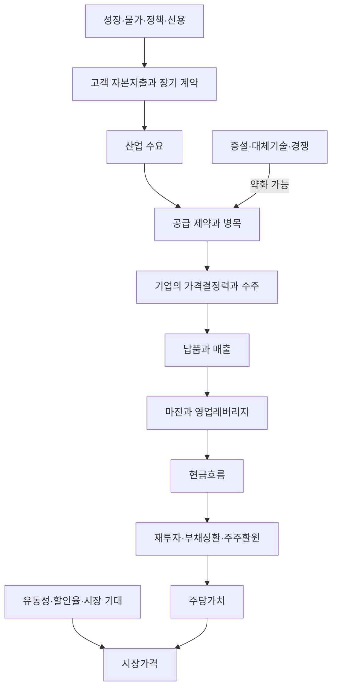

# 거시와 병목의 인과 관계

근거: [[성상현 부부장/출처/돈의 방향]] PDF 188~221, 226~245, 258~266쪽. 아래 도식은 책을 바탕으로 정리자가 만든 인과 가설 지도다. 화살표마다 확인이 필요하며 현재 성립한 사실의 목록이 아니다.

## 확인할 연결과 끊어지는 조건

| 연결 | 확인할 자료 | 연결이 약해지는 조건 |
| --- | --- | --- |
| 자본지출→기업 수주 | 고객 발주·계약, 공급 자격·채택 | 예산 취소, 대체 공급자 채택 |
| 수주→매출 | 납품 일정과 인식 조건 | 프로젝트 지연·취소 |
| 매출→마진 | 판가·원가·제품 믹스·가격 전가 | 저가 계약, 원가 상승, 경쟁 심화 |
| 이익→현금 | 운전자본·CapEx·현금소진 | 매출채권·재고 증가, 투자 부담 |
| 기업 성장→주당가치 | 재투자 수익률·희석·자본 배분 | 저수익 증설, 증자·보상 희석 |

## 유동성과 자금 확산

책은 브로드 유동성을 세계의 신용·자금 흐름으로, 내로우 유동성을 금융시장 내부의 자금조달 흐름으로 구별한다. `연준 총자산 - TGA - ON RRP`는 책에 나온 간이 관찰식이지 모든 유동성을 포괄하는 동일식이 아니다. 시황 수치를 옮겨 현재의 시장 판단을 만들지 않았다.

브로드닝은 유동성 증가 전망에 더해 질서 있는 금리곡선 변화, 달러 흐름, 동일가중 지수·상승 종목 수·업종 이익 전망의 실제 확산으로 확인한다. 책 217~218쪽의 신호 조합과 212~213쪽의 임계점 한계를 함께 읽는다.

## 복기 연결

- 플루언스: 전력 병목과 ESS 수요가 해당 기업의 계약·마진·FCF까지 이어졌는지 나누어 점검한다.
- PoET: 광통신 수요와 기술적 차별성이 고객 채택·양산·매출로 이어졌는지 나누어 점검한다.
- 공통: 두 기업의 결과가 좋거나 나빴다는 사실만으로 산업 전체의 가설을 확정하거나 기각하지 않는다.

연결 원칙: [[성상현 부부장/원칙/SSH-C02 병목의 수혜는 기업의 이익으로 확인한다|C02 병목의 수혜는 기업의 이익으로 확인한다]] · [[성상현 부부장/원칙/SSH-C10 주주가 받는 성장은 자본 배분으로 결정된다|C10 주주가 받는 성장은 자본 배분으로 결정된다]] · [[성상현 부부장/원칙/SSH-C11 거시 국면은 단일 금리선보다 조합으로 판단한다|C11 거시 국면은 단일 금리선보다 조합으로 판단한다]] · [[성상현 부부장/원칙/SSH-C12 자금 확산은 실제 시장 폭과 이익 개선으로 확인한다|C12 자금 확산은 실제 시장 폭과 이익 개선으로 확인한다]].
