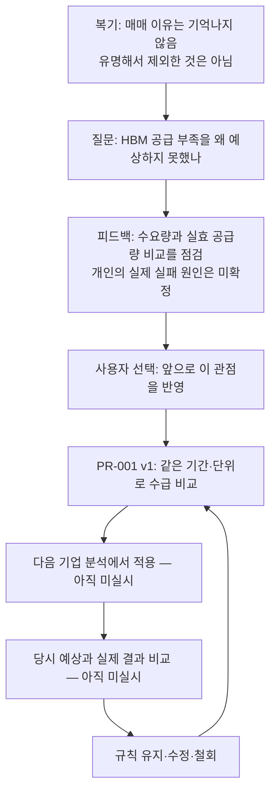

# TR-001 — HBM 수급 예상에서 시작한 훈련

이 문서는 복기·피드백·규칙·재적용을 이어 보는 한 장의 기록이다. 원문과 분석을 섞지 않고 각각의 문서로 연결한다.

| 순서 | 따라갈 문서 | 이 단계에서 확인되는 것 |
| --- | --- | --- |
| 1. 내가 실제로 한 말 | [[복기/투자 사례/SK하이닉스 - 메모리 기회 인식 복기]] | 동기 기억 한계와 분석자 추정에 대한 정정 |
| 2. 무엇을 점검하나 | [[피드백/2026-09-28 HBM 수급 질문과 학습]] | 기록의 공백을 점검. 실제 원인 확정은 아님 |
| 3. 무엇을 새로 배웠나 | [[결과물/HBM 수요와 공급을 비교하는 학습 메모]] | 수요 분해와 공급 제약. 과거 지식 아님 |
| 4. 왜 내 방법을 바꾸나 | [[투자철학/02. 원칙 채택 기록#ADOPT-20260928-001]] | 사용자가 앞으로 반영하라고 지시 |
| 5. 다음에 무엇을 하나 | [[투자철학/개인 투자 규칙/PR-001 수요와 공급의 변화 속도 비교]] | 수요량·실효 공급량·부족 시점·기업 이익·가치 비교 |
| 6. 어디에 적용했나 | [[기업분석/00. 기업분석 기록]] | 현재 실제 적용 사례 없음. 양식만 준비 |
| 7. 적용하니 나아졌나 | 다음 결과 비교 문서 연결 예정 | 효과 미검증. 결과를 만들어 채우지 않음 |

## 다음 훈련에서 비교할 것

- 예전에는 어떤 예상이었고, 새 분석에서는 어떤 예상인가?
- 수요와 공급의 단위·기간을 맞췄는가? 부족한 자료는 무엇인가?
- 정해 둔 기한에 실제 수요·공급·가격·이익은 어떻게 됐는가?
- 가설이 맞았어도 주가·수익이 달랐다면 가격 반영·실행·외부 요인을 어떻게 구분하는가?
- 규칙의 어떤 부분을 유지하거나 바꿀 것인가?

평가 대상은 ‘빠뜨리지 않고 비교했는가’와 ‘예측·행동이 개선됐는가’를 나눠 본다. 체크리스트를 채운 것만으로 투자실력이 개선됐다고 판정하지 않는다.
